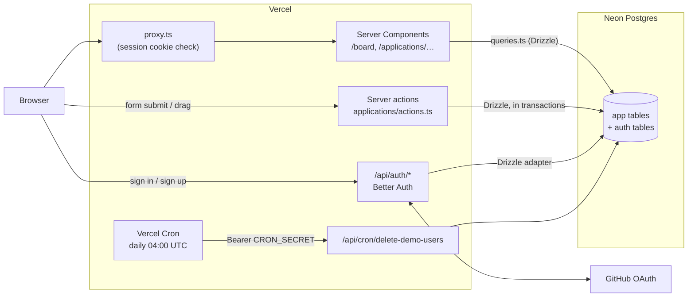
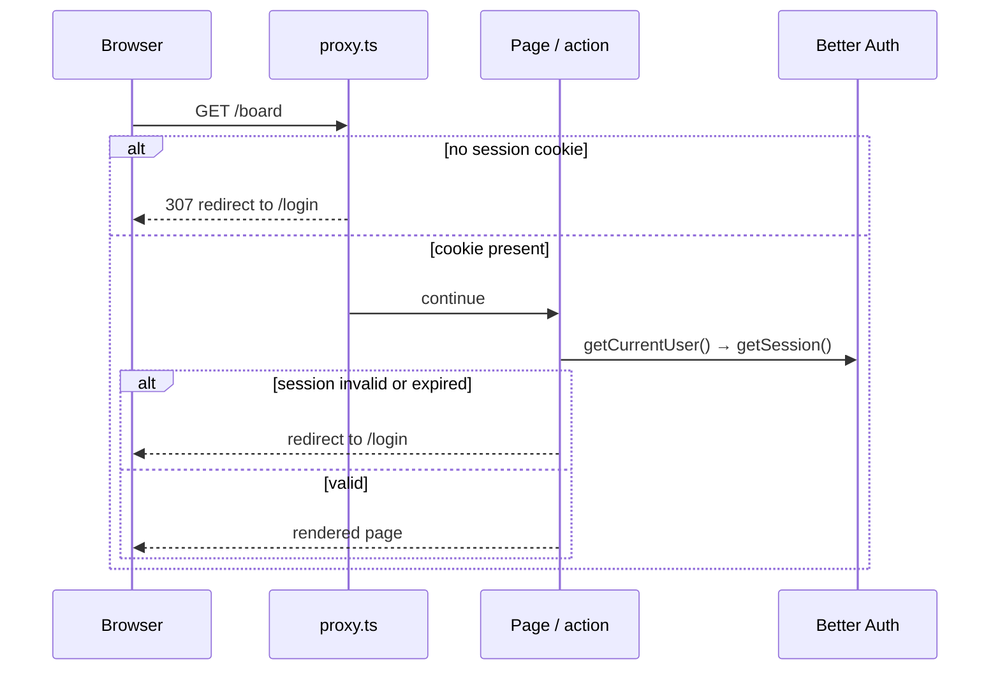

# Architecture

> Last updated 2026-10-30 · reflects commit [`a894636`](https://github.com/m-danie/job-tracker/commit/a894636)

One Next.js app on Vercel, one Postgres database on Neon. There is no separate backend:
pages are React Server Components that query the database directly, and every change
goes through a server action.

## Overview

## Where things live

| Path | What |
|---|---|
| `src/app/(auth)/` | `/login` and `/register`, plus `signOutAction` |
| `src/app/(app)/` | Signed-in pages: `/board`, `/applications/new`, `/applications/[id]`, `/applications/[id]/edit` |
| `src/app/(app)/applications/actions.ts` | All server actions that change applications, interviews and contacts |
| `src/app/api/auth/[...all]/route.ts` | Better Auth's HTTP endpoints |
| `src/app/api/cron/delete-demo-users/route.ts` | Daily cleanup of leftover demo users |
| `src/db/schema/` | Drizzle schema: `auth.ts` (generated by Better Auth), `app.ts` (ours) |
| `src/db/queries.ts` | Reads, always filtered by the user's id |
| `src/db/demo.ts` | Seed data for demo accounts |
| `src/utils/auth.ts` | Better Auth server config |
| `src/utils/session.ts` | `getCurrentUser()`, the only place that reads the session |
| `src/proxy.ts` | Redirects to `/login` when there is no session cookie |
| `src/components/` | Client components: board, forms, dialogs |

Route groups `(auth)` and `(app)` give each set of pages its own layout without adding
a segment to the URL.

## Reading data

Pages are Server Components. They call `getCurrentUser()` and then a function from
`src/db/queries.ts`, which always includes `where user_id = <current user>`. Nothing
reaches the browser except what the page renders.

The app uses **Cache Components**: the static shell of a page is prerendered, and the
parts that read the session are streamed in behind `<Suspense>` boundaries.

## Changing data

Every mutation is a server action in `applications/actions.ts`. Each one:

1. calls `getCurrentUser()` (never trusts the client about who is asking),
2. validates its input with Zod,
3. writes inside a transaction, scoped to rows the user owns,
4. calls `revalidatePath()` so the board and detail pages show the change.

The board uses `useOptimistic`: a dragged card moves at once, the action runs in a
transition, and if it fails the card moves back and a toast explains why. A stage change
locks the application row (`SELECT … FOR UPDATE`) and writes a `stage_event` in the same
transaction, so quick consecutive drags keep their history in order.

## Authentication

Better Auth handles email + password, GitHub OAuth and anonymous (demo) users. The
login and register forms call its endpoints through the browser client
(`src/utils/auth-client.ts`) rather than through server actions, because Better Auth's
rate limits only apply to HTTP requests to `/api/auth/*`. See
[ADR 0005](adr/0005-auth-forms-call-better-auth-from-the-browser.md).

Signed-in pages are protected in two layers:

The proxy only checks that a cookie exists, which is fast but can be fooled.
`getCurrentUser()` verifies the session and returns a narrow user object
(`id`, `email`, `name`, `isDemo`), so session internals never reach components.

Password rules (length plus upper, lower, number and symbol) are checked in the form and
again in a Better Auth `before` hook, so calling the API directly can't skip them.

## Demo accounts

**Log in with a Demo Account** creates an anonymous Better Auth user. A database hook
seeds sample applications for that user as it is created. Each visitor gets their own
copy, so nobody can change what the next visitor sees. The demo user and its data are
deleted on sign-out, and a daily Vercel Cron job deletes demo users older than 24 hours.
Demo sign-ins are rate limited to 5 per 10 minutes per IP. See
[ADR 0006](adr/0006-demo-accounts-with-anonymous-users.md).

## Environments

| Environment | Deploys from | Database | URL |
|---|---|---|---|
| Local | `pnpm dev` | Neon branch `dev` | `localhost:3000` |
| Preview | any pushed branch | Neon branch `dev` | Vercel preview URL (protected) |
| Production | `main` | Neon branch `main` | `jobs.poison-apple.org` |

Each environment has its own `BETTER_AUTH_SECRET`, and local and production use separate
GitHub OAuth apps. There is no staging environment yet
([ADR 0008](adr/0008-no-staging-environment-yet.md)).

## CI

GitHub Actions runs on every push: `pnpm ci` → `pnpm lint` → `pnpm typecheck` →
`pnpm build`. Vercel builds and deploys separately. Automated tests are the next step.
