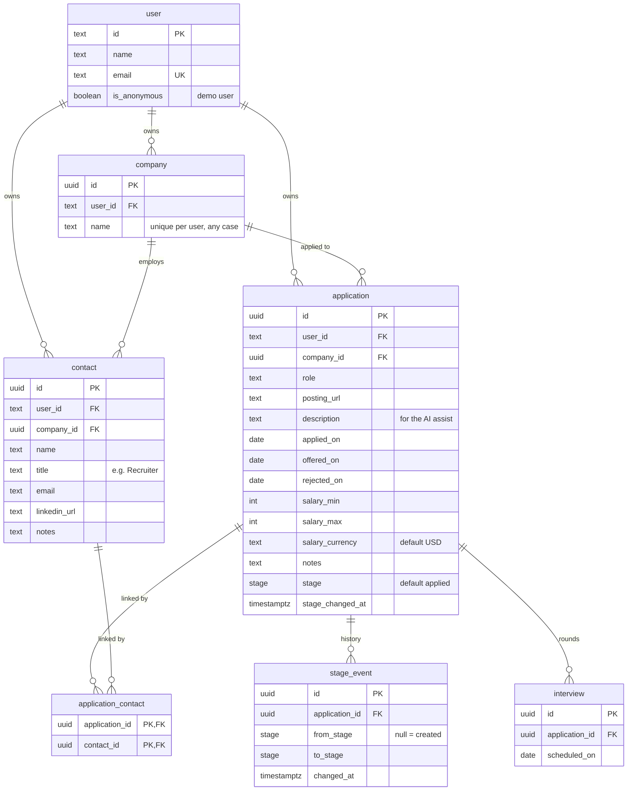

# Data model

> Last updated 2026-10-30 · reflects commit [`a894636`](https://github.com/m-danie/job-tracker/commit/a894636)

The schema is written in TypeScript in `src/db/schema/` and is the source of truth. SQL
migrations in `drizzle/` are generated from it (see [Development](development.md#database-migrations)).

- `src/db/schema/auth.ts`: Better Auth's tables, generated by `pnpm auth:generate`. Don't
  edit by hand.
- `src/db/schema/app.ts`: the job tracker's own tables.

## Diagram

Better Auth's other tables (`session`, `account`, `verification`, `rate_limit`) are left
out of the diagram. `session` and `account` belong to a user and are deleted with it. The
password hash is stored in `account.password`, so one user can have several ways to sign
in (email and GitHub).

## Tables

**`company`**: one row per company per user. A unique index on `(user_id, lower(name))`
means "Acme" and "acme" are the same company. Adding an application reuses an existing
company with the same name.

**`contact`**: a person at a company (recruiter, hiring manager). Contacts belong to the
company rather than to one application, so the same recruiter can be linked to several
roles through `application_contact`.

**`application`**: one job application. `stage` is a Postgres enum: `applied`,
`interview`, `offer`, `rejected`. The stage list lives in `src/utils/stages.ts` so client
components can use it without importing the database schema.

**`stage_event`**: one row per stage change. The first row, with `from_stage` null, is
the creation. It is written in the same transaction as the stage change.

**`interview`**: interview dates for an application, one row per round. A separate table
rather than an array column, because rounds are added, rescheduled and removed one at a
time.

## Dates

`applied_on`, `offered_on`, `rejected_on` and `interview.scheduled_on` are `date`
columns (a day, no time). Moving a card to Offer or Rejected sets that date to today
unless one is given or already set. Timestamps (`created_at`, `stage_changed_at`,
`changed_at`) are `timestamptz`. Dates are shown in UTC for now.

## Deleting

| When this is deleted | What happens |
|---|---|
| A user | Everything they own is deleted (sessions, accounts, companies, contacts, applications and their history) |
| An application | Its stage events, interviews and contact links are deleted. The company and contacts stay |
| A company | Its contacts are deleted. Deleting a company that still has applications fails |

`application.company_id` uses `ON DELETE NO ACTION` rather than `RESTRICT`. Postgres
checks `RESTRICT` straight away, which would block deleting a user, because the user's
companies could be deleted before their applications. `NO ACTION` waits until the end of
the statement, when the applications are gone too.

## Planned

- A `suggestions` table (with the source email's message id, to skip duplicates) for
  mailbox scanning, and a per-user API token.
- Cleaning up companies that no longer have applications or contacts.
